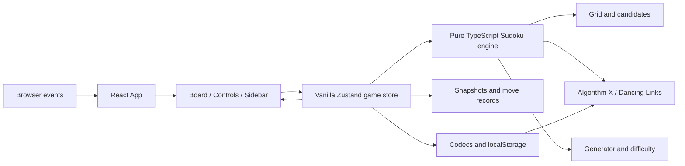

# Sudoku Game

*How the game works: architecture, algorithms, design patterns, and technology stack*

**Codebase reviewed:** /Users/josephcscarpa/sudoku

**Document date:** August 7, 2026

**Executive summary.** This is a browser-only Sudoku application built with React, TypeScript, Vite, and Zustand. Its user interface is deliberately thin: game rules and transitions live in a vanilla Zustand store, while reusable puzzle logic lives in a framework-independent engine. The engine supports 4×4, 9×9, and 16×16 grids; the UI currently offers 9×9 Sudoku and 16×16 Hexadoku. Its most sophisticated algorithm is an exact-cover solver implemented with Knuth’s Algorithm X and Dancing Links. That solver is reused to verify uniqueness during puzzle generation and to reconstruct solutions when restoring locally saved games.

# 1. What the player experiences

The application displays a Sudoku board, a tools and move-history sidebar, and a number/candidate editor. A game consists of immutable given cells and editable player cells. Each player cell stores both a filled value and a sorted list of pencil-mark candidates, so candidates can survive temporarily filling and later clearing that cell.

- Board sizes: standard 9×9 Sudoku and 16×16 Hexadoku are selectable in the New Game dialog. The underlying engine also supports 4×4 boards for tests and reuse.
- Difficulties include Easy, Medium, Hard, and Expert.
- Input works through mouse/touch, number pad, candidate buttons, arrow keys, digits, A–G on 16×16, Escape, Backspace/Delete, and Space for pause.
- Solving aids include peer highlighting, matching-number highlighting, remaining counts, hints, automatic peer-candidate removal, and prevention of direct row/column/box conflicts.
- Every meaningful edit is undoable and redoable. Moves may be flagged as guesses, and the player can return to the snapshot immediately before a flagged guess.
- Session management provides reset, new puzzle generation, import/export, and automatic localStorage persistence.

When a digit is entered, the store rejects edits to givens, paused games, and duplicate row/column/box values when conflict prevention is enabled. A valid edit updates the cell, optionally removes that digit from every empty peer’s candidate list, increments the mistake count if the entry differs from the stored solution, checks for completion, records a human-readable move, and saves the complete pre-move snapshot for atomic undo.

# 2. Architecture at a glance

The architecture follows a **functional-core / imperative-shell** shape. Grid math, solving, generation, validation, and technique simulation are deterministic TypeScript functions under packages/engine. State transitions are concentrated in src/state/gameStore.ts. React components translate state into accessible DOM and route user events back to store actions. Persistence and file transfer sit at the boundary as adapters.

| Layer | Responsibilities | Primary files |
|----|----|----|
| UI shell | Rendering, dialogs, keyboard events, accessible controls | src/App.tsx; src/components/\* |
| Game state | Rules for edits, candidates, mistakes, status, history, guesses, hints | src/state/gameStore.ts |
| Sudoku engine | Grid geometry, legal candidates, exact-cover solving, generation, validation, difficulty techniques | packages/engine/\* |
| Persistence and interchange | localStorage, compact native format, plaintext grids, full manual export/import | src/persist/\*; src/codec/\*; src/game/gameTransfer.ts |
| Quality | Pure unit tests and browser-level interaction tests | \*.test.ts; \*.test.tsx; src/test/\* |

# 3. Core data model

The code uses a small set of domain types to keep rules explicit:

- `BoxSize` accepts 2, 3, or 4. The board width is N = boxSize², yielding 4×4, 9×9, or 16×16.
- `Coordinate` contains r and c and uses zero-based indexes internally.
- `ValueGrid` is a read-only matrix of digits or nulls. `CompleteGrid` contains no nulls.
- `GameCell` contains value, given, and notes, distinguishing the displayed value, whether it is immutable, and its player-managed candidates.
- `GameSnapshot` contains cells, mistakes, and status and is the atomic undo unit.
- `MoveRecord` contains notation, description, and an optional guess flag; it is presentation metadata paired with history.
- `GameState` combines the current board, original board, solution, selection, settings-sensitive actions, timer, status, history/future stacks, and move/redo records.

The store deep-clones cell rows and candidate arrays before mutations. That gives React and Zustand reliable reference changes while preventing one history snapshot from being changed through another snapshot’s nested arrays.

# 4. Grid geometry and candidate calculation

packages/engine/grid.ts centralizes all coordinate math. For a cell, `unitsFor` constructs its entire row, column, and sub-box. `peersFor` concatenates those units, removes the cell itself, and deduplicates coordinates with a Map keyed by `r:c`.

`legalCandidates` is a direct set-difference algorithm:

1.  Return an empty set if the cell is already filled.
2.  Collect every non-null value used by the cell’s peers.
3.  Generate the domain 1…N.
4.  Return digits not present in the excluded set.

For fixed board size, this is effectively constant-time from the UI’s perspective; more formally it visits O(N) peers and O(N) possible digits. The same function is reused by validation and the logical-technique simulator, keeping Sudoku legality in one place.

Symbols are also abstracted from digits. Internally the game always uses integers 1…16. At the UI and text-codec boundary, values 10…16 map to A…G. This avoids contaminating algorithms with display-specific strings.

# 5. Exact-cover solving with Algorithm X and Dancing Links

packages/engine/solver.ts models Sudoku as an **exact-cover problem**. Every possible row/column/digit assignment becomes one candidate row. Choosing that assignment satisfies exactly four constraints:

1.  Every cell receives one value.
2.  Every row contains each digit once.
3.  Every column contains each digit once.
4.  Every box contains each digit once.

For board width N, the matrix has **4N² constraint columns**. An empty puzzle can have up to **N³ candidate rows**, and each candidate row contains exactly four nodes. The code computes the four column indexes as:

    cell       = r*N + c
    row-digit  = N² + r*N + (d-1)
    col-digit  = 2N² + c*N + (d-1)
    box-digit  = 3N² + box*N + (d-1)

The sparse matrix is stored as circular doubly linked lists. `DataNode` has left/right/up/down pointers, and `ColumnNode` additionally tracks how many candidate rows remain. This is Knuth’s **Dancing Links (DLX)** representation.

Algorithm X recursively chooses a constraint, tries each candidate row satisfying it, covers the other constraints in that row, and backtracks by uncovering them in exact reverse order. Pointer splicing makes cover/uncover proportional to the affected sparse nodes rather than the size of a dense matrix.

The implementation applies the standard **minimum remaining values** heuristic: `chooseColumn` selects the uncovered column with the smallest size. This attacks the most constrained decision first and sharply reduces branching. A zero-size column proves that branch impossible.

**Reusable early termination.** `solve` searches with a limit of 1 and materializes the first solution. `countSolutions` defaults to a limit of 2. The latter does not need the exact total: zero means impossible, one means unique, and two means “not unique,” so stopping at two is a major performance optimization during generation.

# 6. Puzzle generation and uniqueness

## 6.1 Creating a complete randomized solution

packages/engine/generator.ts does not solve an empty board from scratch. It starts from a known Latin/Sudoku pattern:

    pattern = (r*b + floor(r/b) + c) mod N

where `b` is the box size. It then produces many equivalent valid boards by shuffling:

- row bands and rows within each band,
- column stacks and columns within each stack, and
- the mapping from pattern positions to digits.

All shuffles use Fisher–Yates. The random-number function is injectable, which allows deterministic tests. This construction is fast and guarantees a complete valid grid without search.

## 6.2 Removing clues safely

The generator copies the solution, randomizes all cell positions, and considers removing clues one at a time. After each tentative removal it calls `countSolutions` with a search limit of two. The clue stays removed only when the puzzle still has exactly one solution; otherwise it is restored. This is a greedy uniqueness-preserving algorithm.

The target clue count is a goal, not a mathematical guarantee: if every remaining removal would introduce multiple solutions, the pass can finish with more clues than requested. The approach also does not enforce visual symmetry or minimality, but it is simple, safe, and works for every supported board size.

# 7. Difficulty rating

Difficulty combines clue counts with a lightweight human-technique simulator in packages/engine/techniques.ts.

- **Naked single:** an empty cell has exactly one legal candidate.
- **Hidden single:** within a row, column, or box, a missing digit has exactly one legal home even if that cell has several candidates.

`solveWithSingles` repeatedly scans for a naked single, then optionally scans all units for a hidden single. It records placements and the hardest technique used. It stops when solved or when neither technique can advance the grid.

| 9×9 rating | Nominal clues | Technique rule                               |
|------------|---------------|----------------------------------------------|
| Easy       | 50            | Solvable with naked singles only             |
| Medium     | 40            | Solvable with naked and hidden singles       |
| Hard       | 32            | Not solved by singles and more than 27 clues |
| Expert     | 26            | Not solved by singles and at most 27 clues   |

Generation tries up to eight candidate puzzles. Easy/Medium generation may reveal additional solution cells until the accepted logic rating is reached. Hard/Expert candidates are accepted when their rating matches. For 16×16, the current implementation uses clue-count profiles only (192, 176, 160, and 144); it does not run the 9×9 singles rater.

# 8. Contradiction detection and entry prevention

packages/engine/validate.ts defines four progressively more expensive validation levels:

| Level | Contradiction | How it is found |
|----|----|----|
| 0 | Duplicate | The same digit occurs more than once in a row, column, or box. |
| 1 | Dead cell | An empty cell has zero legal candidates. |
| 2 | Missing home | A unit lacks a digit and none of its empty cells can legally hold it. |
| 3 | Unsolvable | The exact-cover solver finds zero completions. |

The board renderer requests only level 0 to highlight direct duplicates cheaply. The newly wired conflict-prevention setting performs an even narrower preflight check: before accepting a digit, it visits the selected cell’s deduplicated peer list and rejects the move if a peer already has that digit. Because the rejection happens before snapshot creation, a blocked entry creates no move, no undo record, and no mistake.

Automatic candidate cleanup uses the same peer list. After placing a digit, it removes that digit from every empty peer’s notes. The placement and all candidate removals are included in the same cloned cell matrix and therefore the same history snapshot. One Undo restores both the filled cell and every removed candidate atomically.

# 9. State management, undo/redo, and guesses

The game uses **vanilla Zustand** through a factory, `createGameStore(setup)`. This is an important design choice: the domain store is not tied to React hooks and can be created directly in unit tests, persistence code, or future non-React clients. React subscribes through Zustand’s `useStore` adapter.

## 9.1 Immutable transition pattern

Each action follows the same shape:

1.  Read current state with `get()`.
2.  Validate guards and return early when the action is illegal or a no-op.
3.  Deep-clone cells only when a board mutation will happen.
4.  Apply all effects to the clone.
5.  Append the pre-move snapshot and move description.
6.  Clear the redo branch because a new action establishes a new linear future.
7.  Publish one atomic update with `set()`.

## 9.2 Memento pattern

Undo/redo is an explicit implementation of the **Memento pattern**. The `history` stack holds snapshots from before active moves, while `future` holds snapshots that were undone. `moves` and `redoMoves` mirror those stacks with readable metadata.

- Undo restores the last history snapshot and pushes the current snapshot to the front of future.
- Redo restores the first future snapshot and appends the current snapshot to history.
- A new edit after undo clears future and redoMoves, producing conventional linear history.

Full snapshots make correctness easy—multi-cell candidate cleanup needs no custom inverse operation—but cost O(MN²) cell storage for M moves. This is a reasonable tradeoff for typical Sudoku sessions, though a patch/delta representation would scale better for extremely long 16×16 histories.

## 9.3 Guess checkpoints

A move can be flagged with `isGuess`. Returning to a guess restores `history[moveIndex]`, which is the board immediately before that move, truncates active history, and moves the later snapshots and move descriptions into the redo stacks. This is a checkpoint layered on top of the linear memento history; it is not a persistent history tree.

# 10. UI composition and interaction design

React is used as a rendering and event-routing layer:

- App owns modal and UI-setting state, registers keyboard input, creates new games, and composes the three main regions.
- SudokuBoard derives peer, matching, and duplicate-conflict sets, renders cells, and renders fixed-position candidate mini-grids.
- GameControls renders the selected-cell inspector, candidate editor, number pad, and remaining counts.
- GameSidebar provides tools, move history, guess controls, import/export, reset confirmation, and settings.

The candidate mini-grid is data-driven: its CSS grid dimension is the box size, so 9×9 uses a 3×3 candidate layout and 16×16 uses 4×4. Candidate slots never collapse, which preserves spatial scanning.

Dialogs are rendered with React portals into `document.body`. ARIA roles and names are used throughout: the board is a grid, candidate and number pads are groups, dialogs are modal and labelled, transfer messages use live status, and each cell exposes row, column, value, and given state. The test suite exercises the application through those same accessible roles.

# 11. Persistence and file formats

## 11.1 Automatic localStorage persistence

src/persist/gamePersistence.ts subscribes to every Zustand state update through the **Observer pattern**. It saves a compact `sudoku-clone/v1` JSON payload containing:

- the givens as a compact plaintext grid,
- only non-given cells that have a value or candidates,
- elapsed time, mistakes, difficulty, status, selection, and creation time.

On restore, the adapter validates the JSON, parses the givens, recomputes a solution with the exact-cover solver, loads a clean game, bounds-checks every saved cell, and overlays player progress. This avoids persisting a trusted solution and verifies that saved givens are actually solvable.

## 11.2 Manual import/export

The sidebar’s manual transfer path serializes the fuller `RestorableGame`: current and initial cells, solution, history/future snapshots, moves/redoMoves, timer, mistakes, status, size, and difficulty. Export uses a Blob and temporary object URL; import uses File.text or FileReader and restores through the store.

## 11.3 Adapter and codec patterns

Persistence depends on the browser-standard `Storage` interface rather than directly on localStorage, enabling in-memory fakes in tests. Plaintext and native JSON codecs isolate parsing, validation, and formatting from game logic. This is an **Adapter pattern**: external representations change at the boundary while the store continues to use domain types.

# 12. Design patterns in the codebase

| Pattern | Where it appears | Why it helps |
|----|----|----|
| Functional core / imperative shell | packages/engine versus React/browser adapters | Algorithms stay deterministic, reusable, and easy to test. |
| Factory | `createGameStore(setup)` | Creates isolated games for production, tests, and restores. |
| Memento | history/future snapshots | Makes multi-cell moves atomically reversible. |
| Observer | Zustand subscriptions and React useStore | UI and persistence react to state without manual synchronization. |
| Adapter / Codec | Storage, native JSON, plaintext, manual transfer | Separates external formats from domain logic. |
| Strategy by data profile | Difficulty profiles and injected random function | Changes generation behavior without duplicating the generator. |
| Dependency injection | StoreApi prop, Storage parameter, random function | Enables deterministic, isolated tests with real behavior. |
| Guard clauses | Every store action and decoder | Illegal/no-op paths exit before mutation or history creation. |
| Derived view model | peer sets, remaining counts, conflict sets | Keeps display-only state out of the persistent domain model. |

MoveRecord is *command-like* metadata, but the code does not implement a full Command pattern because undo uses snapshots rather than inverse commands.

# 13. Technology stack

| Technology | Version | Role |
|----|----|----|
| React | 19.1.1 | Component rendering, local modal/settings state, effects, portals |
| React DOM | 19.1.1 | Browser root and portal rendering |
| TypeScript | 5.9.2 | Strict domain types, readonly contracts, discriminated unions |
| Zustand | 5.0.7 | Framework-independent game store and React subscription |
| Vite | 7.1.x declared | Development server and production bundling |
| @vitejs/plugin-react | 5.0.2 | React transform and fast development workflow |
| Vitest | 3.2.x declared | Unit and integration test runner |
| Testing Library | React 16.3.0; user-event 14.6.1 | Accessible, user-centered component testing |
| jsdom | 26.1.0 | DOM environment for browser tests under Node |
| CSS | Handwritten | Responsive layout, board/candidate grids, visual states; no CSS framework |
| Browser APIs | Native | localStorage, Blob, object URLs, FileReader, keyboard events |

The project targets ES2022, uses ES modules and bundler-style module resolution, enables strict TypeScript checking, and requires Node 20.19 or newer.

# 14. Testing strategy

The test suite is layered rather than mock-heavy:

- Pure engine tests cover grid geometry, symbols, legal candidates, solver behavior, solution counting, generation uniqueness, validation levels, and logical techniques.
- State tests cover moves, candidate cleanup, contradiction prevention, atomic undo, redo, guesses, hints, restart, and game loading.
- Codec and persistence tests cover round trips, malformed input, local save/restore, and move history transfer.
- React integration tests exercise actual components with Testing Library and user-event through accessible names.

Random generation accepts an injected random function, and App accepts an injected Zustand StoreApi. These seams make tests deterministic without adding test-only methods to production code. At the time of this review, the complete runtime suite contains 64 passing tests across 13 test files.

# 15. End-to-end data flows

## 15.1 Entering a digit

1.  A board click selects a coordinate; a number-pad click or keyboard symbol calls `inputDigit`.
2.  The store checks status, selection, given state, repeated value, and settings.
3.  Peer geometry checks direct conflicts.
4.  The board is cloned; the value and peer-candidate cleanup are applied.
5.  The stored solution determines mistake increment and completion.
6.  The old state enters history; a MoveRecord is appended; redo state is cleared.
7.  Zustand notifies React and the localStorage subscriber.
8.  React recomputes highlights, counts, conflicts, and visible controls from the new state.

## 15.2 Starting a new game

1.  The player selects size and difficulty.
2.  The generator constructs and randomizes a complete solution.
3.  Clues are removed greedily while the exact-cover solver preserves uniqueness.
4.  For 9×9, technique simulation rates or adjusts the puzzle.
5.  `loadGame` creates given/player cells and resets transient state and history.
6.  The persistence observer saves the new session.

# 16. Complexity and tradeoffs

- Peer and legal-candidate work takes O(N) per query for N×N boards.
- Duplicate validation takes roughly O(N²) across all cells, with small set/map overhead.
- Exact-cover search is exponential in the worst case, as generalized Sudoku solving is NP-complete; DLX sparsity, smallest-column selection, givens, and early limits make practical instances fast.
- Generation may issue many solver calls—up to one uniqueness check per attempted clue removal, plus retries for difficulty.
- History uses O(MN²) memory because moves store complete snapshots. This favors simple, reliable atomic undo over maximal compactness.
- Compact automatic saves omit undo/redo history, while manual export preserves it. The two paths optimize for different goals.

# 17. Current implementation boundaries

This section distinguishes current behavior from architecture that is scaffolded or suggested by names.

- The engine supports 4×4, but the New Game UI intentionally exposes only 9×9 and 16×16.
- `elapsedMs`, `tick`, and pause behavior exist in the store, but App does not currently schedule a timer interval, so elapsed time does not advance automatically in this snapshot.
- The `lost` status exists, but incorrect entries currently keep the game in `playing`; there is no three-mistake transition despite the dormant overlay copy.
- `notesMode` and several UiSettings fields are scaffolded but are not currently connected to visible controls or behavior. Candidate editing is direct.
- UI settings live in App component state and reset on reload; automatic game persistence saves the game, not settings.
- Undo/redo is linear. Guess checkpoints reuse that linear future rather than maintaining a persistent branch tree.
- The board highlights only level-0 duplicate contradictions even though the engine can detect deeper levels.
- The runtime tests and direct Vite bundle pass, but the repository-wide TypeScript build currently reports errors in src/game/gameTransfer.ts. That parser should be repaired before treating `npm run build` as a clean release gate.

# 18. Source map for maintainers

| Area | Start here |
|----|----|
| Boot and composition | src/main.tsx; src/App.tsx |
| Rules and transitions | src/state/gameStore.ts |
| Grid geometry | packages/engine/grid.ts |
| DLX solver | packages/engine/solver.ts |
| Generation | packages/engine/generator.ts |
| Human techniques/difficulty | packages/engine/techniques.ts; src/game/difficulty.ts |
| Contradictions | packages/engine/validate.ts |
| Board rendering | src/components/SudokuBoard.tsx |
| Controls and candidates | src/components/GameControls.tsx |
| History/settings/import UI | src/components/GameSidebar.tsx |
| Automatic persistence | src/persist/gamePersistence.ts |
| Formats | src/codec/native.ts; src/codec/plaintext.ts; src/game/gameTransfer.ts |

# 19. Running and developing the game

    npm run dev        # Vite development server, usually http://localhost:5173
    npm test           # Run the Vitest suite once
    npm run test:watch # Watch-mode tests
    npm run typecheck  # Strict TypeScript project check
    npm run build      # Type-check, then create the production bundle

Node 20.19 or newer is required. The application has no backend and no database; game data stays in the browser unless the player explicitly exports a file.

------------------------------------------------------------------------

*This document describes the implementation present in the reviewed workspace, not only the aspirational design notes. Where the two differ, current source behavior is treated as authoritative.*
